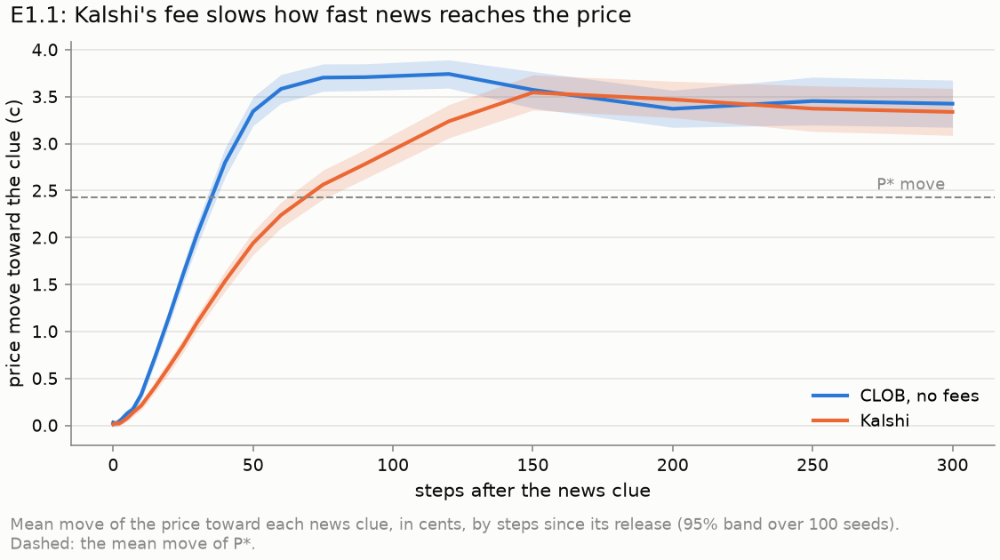
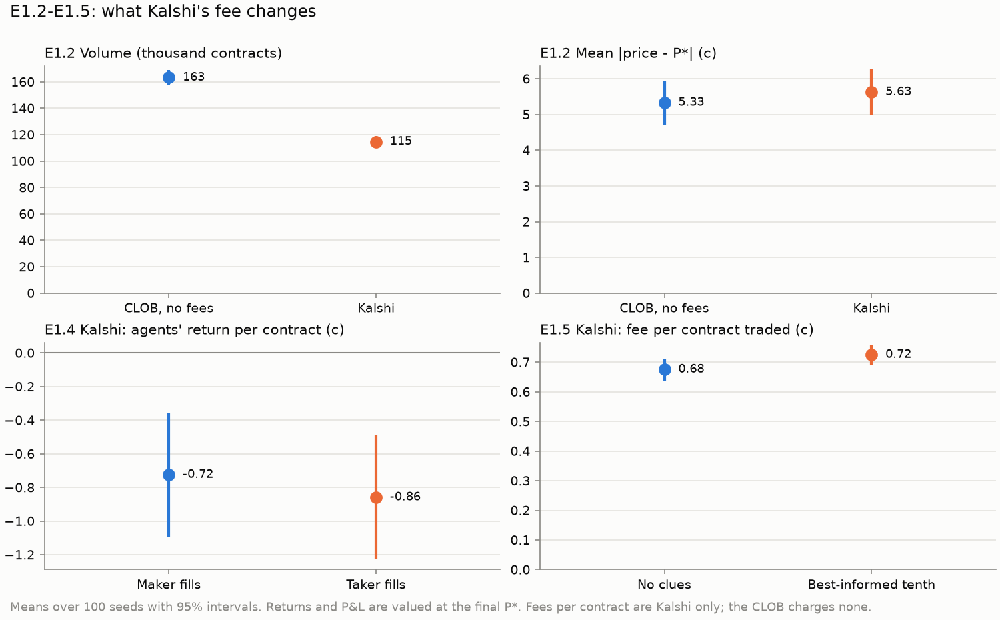
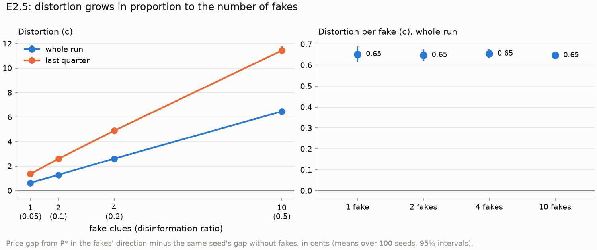
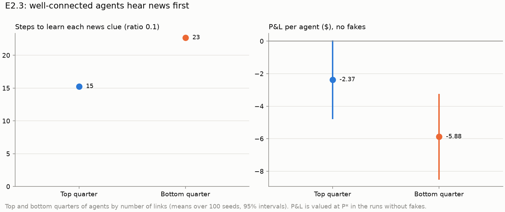
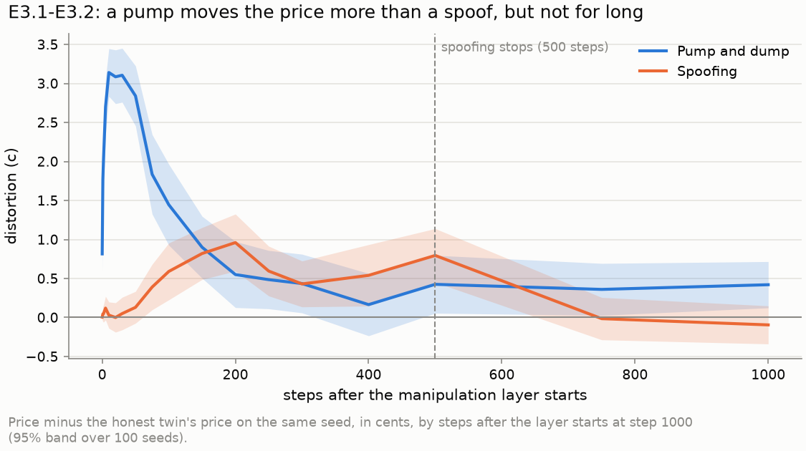
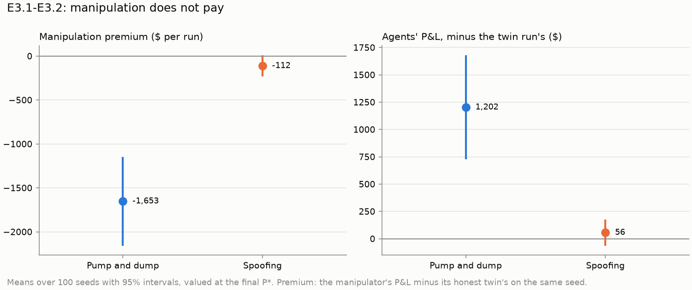
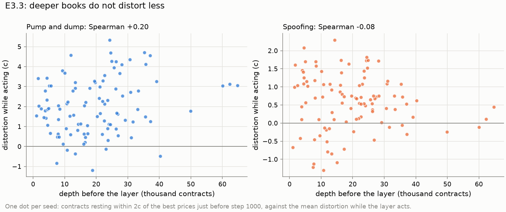

# Results

Each prediction in `PREDICTIONS.md` against the data, for the Step 8c model: only informedness and cash vary across agents, every other trait is one value for all, the defaults are recalibrated (`PLAN.md` Step 8c) and rounded in `configs/default.toml`, and the only network is Holme-Kim. Every configuration ran on seeds 20000-20099 with the conservation invariants checked every step (no violations). Values are means over seeds with 95% intervals: `+-` is a normal interval on the mean or on a paired difference, `[low, high]` a bootstrap interval over seeds (paired across configurations). The per-run data are in `results/e1_rules.csv`, `results/e2_information.csv`, and `results/e3_manipulation.csv`. The JSON file beside each records the commit, seeds, and full configurations. `uv run python experiments/e1_rules.py summary` (or `e2_information.py summary`, `e3_manipulation.py summary`) reprints every number here from those files, and `uv run python experiments/figures.py` redraws the figures in `results/figures/` from them. A news clue's move is measured over the 300 steps after its release. `uv run python experiments/plot_run.py <seed>` charts a single run.

P&L "at P*" values each agent's closing position at the final `P*` instead of the outcome. Without disinformation this has the same expectation as realized P&L with far less outcome luck (`metrics.expected_pnl`), so it is reported for E1 and for E2 without fakes only.

## The calibrated default

`experiments/validate_defaults.py` checked the rounded defaults on four fresh sets of 120 seeds (50000-50479). On every set the median spread is 1c, fill sizes are 6/17/46/113 contracts at the 25th/50th/75th/90th percentiles (Kalshi 2.1/10/35/105; the pattern averages the log error over the four), 0.2% of steps have an empty book side, and the calibration slope is 1.28 to 1.33 (band 0.8-1.4, `PLAN.md` Section 2.2). The price's Brier score beats the average agent's own judgment by 0.008 to 0.022. The best-informed tenth earn $84 to $102 per agent at `P*` on every set, and agents with no clues lose $14 to $17. Rounding changed none of these by more than a few percent from the unrounded calibration.

Context for every result: in the Kalshi market the final price sits 15.7c from 50c on average against 18.7c for `P*`, with a logit slope on `P*` of 0.69, so the price is underconfident (too close to 50c). The mean gap `|price - P*|` is 5.6c (5.3c in the CLOB), against 3.5c in the Step 8b model. Final Brier scores are 0.195, against 0.185 for `P*` and 0.25 for a constant 50c.

## E1. Kalshi rules

| Metric | CLOB | Kalshi |
|---|---|---|
| Mean `|price - P*|` (c) | 5.33 +- 0.62 | 5.63 +- 0.65 |
| Final Brier | 0.193 +- 0.027 | 0.195 +- 0.028 |
| News move by lag 300 (c) | 3.43 +- 0.25 | 3.34 +- 0.25 |
| News half-life (steps) | 26.2 [24.7, 27.7] | 43.2 [40.1, 46.4] |
| Volume (contracts) | 163,240 | 114,656 |
| No-trade steps | 61% | 73% |
| Median spread (c) | 1.01 | 1.00 |
| Depth within 2c (contracts) | 7,660 | 17,738 |
| Empty-book steps | 0.6% | 0.2% |
| Market-maker P&L ($/run) | +81 +- 12 | +19 +- 5 |
| P&L at `P*`, no clues / top tenth ($/agent) | -8.2 / +66.9 | -11.1 / +60.9 |

A news clue moves `P*` by 2.43c on average, so both markets move further than `P*` on news (3.4c by lag 300): the underconfident price catches up on earlier evidence when news arrives.

| Prediction | Verdict | Evidence |
|---|---|---|
| E1.1 The fee slows the pricing of news, most near 50c | **Partly held** | Kalshi's news half-life is 17.0 [14.5, 19.5] steps longer than the CLOB's (43.2 vs 26.2), but by lag 300 the move is the same (difference -0.09 +- 0.12c). The near-50c part is not supported: near 50c Kalshi's move is 0.15 +- 0.32c larger than the CLOB's, outside 40-60c 0.19 +- 0.26c smaller, a difference of 0.34 [-0.11, 0.80]c in the opposite direction to the prediction and not significant (6.2 news clues per run arrive near 50c, 10.8 outside). |
| E1.2 Fees cut volume much more than accuracy | **Held** | From the CLOB to Kalshi, volume falls 29.8% [27.4, 32.2] while mean aggregation error rises 5.5% [4.2, 7.0] (0.29 +- 0.08c). Final Brier scores do not differ (+0.002 +- 0.003). |
| E1.3 Free maker orders draw agents into making | **Held, small** | Agents are the maker on 99.0% of Kalshi contracts vs 97.7% in the CLOB (+1.3 +- 0.2 points), and Kalshi's book holds 2.3 times the depth. |
| E1.4 Makers out-earn takers on Kalshi | **Not supported** | Valued at `P*`, agents' maker fills earn -0.73 +- 0.37c per contract and their taker fills -0.86 +- 0.37c after fees, a gap of 0.13 +- 0.74c. Realized at the outcome the gap is 0.72 +- 2.92c. The direction is right but neither gap is significant. |
| E1.5 The fee falls hardest on the uninformed | **Failed** | Agents with no clues pay 0.68 +- 0.04c in fees per contract traded, the top tenth 0.72 +- 0.04c (difference -0.05 +- 0.06c, not significant). The reason the prediction gave, patience rising with informedness, is gone since Step 8c (`PREDICTIONS.md`, Amendments). |

## E2. Information spread

E2 is the disinformation sweep on Holme-Kim. News reaches half the agents 18.0 +- 0.3 steps after release in every configuration (fakes spread on their own random numbers, so real news spreads identically).

| Ratio | Fakes | News half-life (steps) | Distortion (c) | Last quarter (c) | Mean `|price - P*|` (c) | Final Brier |
|---|---|---|---|---|---|---|
| 0 | 0 | 43.2 [40.1, 46.4] | - | - | 5.63 +- 0.65 | 0.195 |
| 0.05 | 1 | 44.0 [40.7, 47.0] | 0.65 +- 0.04 | 1.37 +- 0.11 | 5.89 +- 0.68 | 0.205 |
| 0.1 | 2 | 43.3 [40.8, 46.0] | 1.30 +- 0.06 | 2.60 +- 0.14 | 6.16 +- 0.71 | 0.217 |
| 0.2 | 4 | 43.0 [40.4, 45.8] | 2.62 +- 0.09 | 4.90 +- 0.18 | 6.90 +- 0.78 | 0.242 |
| 0.5 | 10 | 41.9 [38.9, 44.9] | 6.47 +- 0.17 | 11.44 +- 0.32 | 9.81 +- 0.96 | 0.313 |

| Prediction | Verdict | Evidence |
|---|---|---|
| E2.1-E2.2, E2.4 | **Withdrawn** | They compared networks; E2 now uses Holme-Kim only (`PREDICTIONS.md`, Amendments). |
| E2.3 Well-connected agents hear news earlier and earn more | **Partly held** | The top degree quarter learns each news clue 7.4 +- 0.1 steps before the bottom quarter (15.3 vs 22.7). It does not earn significantly more: without fakes, valued at `P*`, the gap is $3.5 +- 4.0 per agent; at ratio 0.1, realized, $0.1 +- 20.2. |
| E2.5 Distortion grows faster than the ratio | **Failed** | Distortion is proportional to the number of fakes: 0.65c per fake at every ratio, 1 to 10 fakes (changes between ratios -0.00 +- 0.03, 0.01 +- 0.02, and -0.01 +- 0.01c). Each heard fake shifts a belief by a fixed amount, so fakes add up rather than feed on each other, even at ratio 0.5. |

## E3. Manipulation

All three configurations add the same manipulator to the Kalshi default (`PLAN.md` Section 2.3): 5% of the agents' cash, the population's trait values with 2 private clues, a turn every step, and a layer from step 1000. Each seed ran the three together. Distortion is the price minus the twin's price on the same seed, in cents; P&L is valued at final `P*`.

| Metric | Twin | Pump and dump | Spoofing |
|---|---|---|---|
| Manipulator P&L at `P*` ($/run) | -160 +- 218 | -1,813 +- 572 | -272 +- 252 |
| Premium over the twin at `P*` ($) | - | -1,653 +- 505 | -112 +- 122 |
| Premium, realized at the outcome ($) | - | -3,156 +- 2,370 | -22 +- 521 |
| Distortion while the layer acts (c) | - | 2.00 +- 0.27 | 0.58 +- 0.15 |
| Distortion, 300 steps after (c) | - | 0.33 +- 0.26 | 0.20 +- 0.13 |
| Peak of the mean distortion curve (c) | - | 3.14 [2.97, 3.50], 10 steps in | 0.96 [0.74, 1.33], 200 steps in |
| Steps until it falls below half the peak | - | 92 [69, 126] | 285 [237, 646] |
| Steps the layer acted | - | 163 | 500 |
| Contracts bought / sold by the layer | - | 23,127 / 8,112 | 61 / 6,493 |
| Agents' gain over the twin run ($/run) | - | +1,202 +- 477 | +56 +- 119 |
| Change in fees ($/run) | - | +450 +- 84 | +57 +- 19 |
| Volume (contracts) | 120,089 | 150,674 | 123,602 |

The market maker's P&L changes by about $1 in either case. The pump reached its 5c target in 89% of runs but sold back only about a third of what it bought: the price soon fell back to its start, below which the dump does not sell. The twin's presence alone barely changes the Kalshi default (paired against E1 on the same seeds): mean `|price - P*|` rises by 0.22 +- 0.11c, volume by 5,433 +- 1,336 contracts (5%), and the best-informed tenth earn $7.8 +- 5.0 more per agent at `P*`.

| Prediction | Verdict | Evidence |
|---|---|---|
| E3.1 Pump and dump moves the price but loses money | **Held** | While it acts the price sits 2.00 +- 0.27c above the twin's (peak 3.14c), and the pump loses $1,653 +- 505 more than its twin. Agents gain $1,202 +- 477 from it and the fee pot $450 +- 84. The best-informed tenth sold it 33% of its contracts against 24% by chance (per-seed gap +0.08 +- 0.04). |
| E3.2 Spoofing profits, to the extent agents read book depth | **Failed** | The spoofed bid lifts the price 0.58 +- 0.15c while it rests (peak 0.96c), but the spoofer earns no premium (-$112 +- 122). The depth-reading comparison can no longer be made: every agent now reads depth with the same `w_depth` (0.1), so the spoofer's buyers cannot read it more than buyers in general (`PREDICTIONS.md`, Amendments). The fake bid filled in 28% of runs (61 +- 35 contracts). |
| E3.3 More liquid runs distort less, and for less time | **Failed** | Across seeds, depth just before the start is not negatively correlated with distortion. For the pump it leans the other way: Spearman 0.20 [0.01, 0.37] while acting (0.34 [0.18, 0.50] with depth averaged over the 100 steps before, and 0.38 [0.18, 0.56] after). For spoofing it is -0.08 [-0.27, 0.12] while acting and -0.16 [-0.37, 0.03] after. In deeper books the pump buys more before reaching its target (Spearman 0.48 between mean depth and contracts bought), and loses more (premium correlation -0.23 [-0.42, -0.04] with mean depth). |

## Earlier versions of the model

**First model (Step 8).** The first run of E1 and E2 used the averaging belief rule, `(1 - w_market) * (L_own + w_hearsay * L_heard) + w_market * logit(mid)`, with cash unrelated to informedness and a 90-step news window. Its price stayed within about 5c of 50c (against 19c for `P*`), moved 0.17-0.19 logit units per unit of `logit(P*)`, and missed `P*` by 14c on average, so a 60c price meant about 88% YES. Under it E1.2, E1.3 (small), E2.1, and E2.2 held, E1.1 and E2.3 partly held, and E1.4, E1.5 (reversed), E1.6, E2.4, and E2.5 failed. Because those results could not speak to price accuracy, Step 8b changed the belief rule and linked cash and belief noise to informedness.

**News as hearsay (Step 8b, first calibration).** With those changes but relayed news still counted as hearsay, the Kalshi price missed `P*` by 6.0c on average and moved 0.73c per news clue against a 2.43c `P*` jump, because the cash-rich informed discount hearsay. Its informed tenth earned -$51 to +$18 per agent across fresh seed sets.

**Step 8b model.** Eleven trait distributions with four links to informedness, and five networks in E2. The Kalshi price missed `P*` by 3.5c, with a calibration slope of 1.10-1.18 on fresh seeds, and the informed-earn pattern failed on one of four fresh seed sets. E1.1 partly held; E1.2, E1.4, and E1.5 held; E1.3 held, tiny. E2.1 and E2.2 held, E2.3 held small, and E2.4 and E2.5 failed. E3.1 held, E3.2 partly held (the spoofer's buyers read depth more than buyers in general, 0.175 vs 0.139, but it earned no premium), and E3.3 failed.

Predictions were never changed, only amended (`PREDICTIONS.md`). Against the Step 8b model, E1.4 and E1.5 no longer hold, E2.3 holds only for spreading, and E3.2's depth-reading part cannot be tested: each of these leaned on trait differences between agents that Step 8c removed.

## What this means for the model

- With only informedness and cash varying, prices still aggregate information and pass every calibration pattern, but less tightly than before: the price misses `P*` by about 5.5c rather than 3.5c, and it is more underconfident (slope 1.28-1.33 on fresh seeds, 0.69 logit units per unit of `logit(P*)` at the end of a run). It moves further than `P*` on news, catching up on evidence it had underweighted.
- Fees act on liquidity and speed, not accuracy. Kalshi's fee cuts volume by 30% and makes 73% of steps trade-free, slows news pricing (half-life 17 steps longer), and raises mean error only 5%, while the book more than doubles its depth.
- The makers-beat-takers and uninformed-pay-more results of Burgi et al. (2025) do not appear when every agent shares one patience: they depended on informed agents being more patient. This is the cost of the simpler population, and it marks patience as the trait whose spread matters most for E1.
- Manipulation does not pay. A pump moves the price about 3c for under a hundred steps and loses money to the informed, who sell to it; a spoof lifts the price about half a cent and earns nothing. Deeper books do not protect against the pump in this model: the pump keeps buying until it reaches its target, so it simply buys more. The liquidity result of Rasooly & Rozzi (2025) is not reproduced, and the spoofing result is conditional on `w_depth`, which has no data anchor.
- Disinformation distorts the price in proportion to the number of fakes, 0.65c each, up to 10 fakes. Distortion builds over the run (it is about twice as large in the last quarter), and at ratio 0.5 the final Brier score (0.313) is worse than always guessing 50c (0.25).
